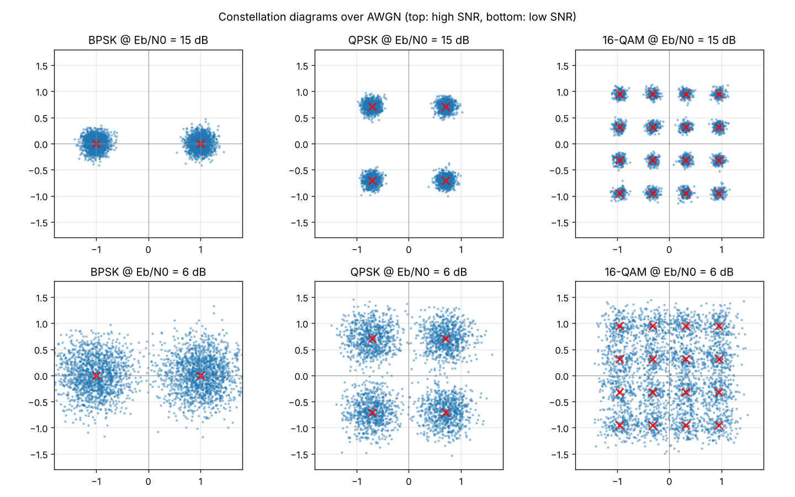
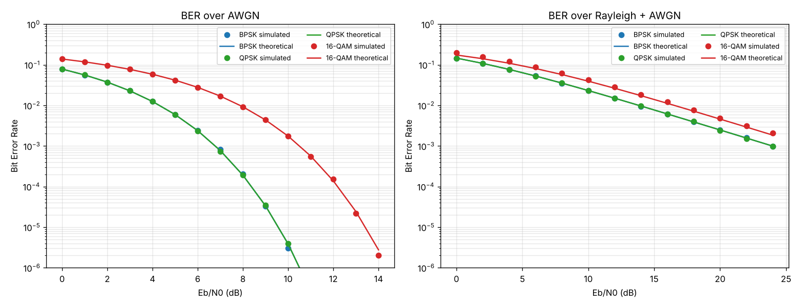

# 📡 Digital Communication System Simulator

[](https://github.com/County4Bounty/digital-comm-simulator/actions/workflows/tests.yml)


An interactive, **software-only** simulator of a complete digital communication link, built for Electronics & Communication Engineering (ECE) coursework. Type a message, pick a modulation scheme and a noise level, and watch the receiver recover (or corrupt) your text, with constellation plots and BER-vs-Eb/N0 curves compared against theory.

No Arduino, sensors or RF hardware needed — everything runs on a laptop.

```
Text → Bits → Modulation → Channel (noise) → Demodulation → Bits → Text → BER
        (BPSK / QPSK / 16-QAM)   (AWGN / Rayleigh)
```

## ✨ Features

- **Text ↔ binary** conversion (UTF-8), with side-by-side transmitted/received bits
- **Modulation:** BPSK, QPSK and 16-QAM (Gray mapped, unit average symbol energy)
- **Channels:** AWGN and flat Rayleigh fading + AWGN (coherent receiver, perfect CSI)
- **Eb/N0 slider** — watch the message degrade as noise increases
- **Constellation diagram** and **waveform view** (transmitted vs received)
- **Monte-Carlo BER** vs **theoretical BER**, with an option to compare all schemes
- **Message recovery** — see exactly which characters get corrupted
- **CSV export** of the BER results
- Clean separation: simulation core (`dcs/`) is independent of the GUI and fully unit-tested

## 📊 Results

### Constellations over AWGN
At high SNR the received points cluster tightly around the ideal points (red ×); at low SNR the clouds spread across decision boundaries and bit errors appear.



### BER vs Eb/N0
Simulated points (markers) agree with theory (lines). BPSK and QPSK have identical BER per bit, so their curves overlap; 16-QAM needs roughly 4 dB more Eb/N0 for the same BER over AWGN, and fading flattens the curves dramatically.



> The figures above are generated from the simulator itself: `python scripts/make_readme_figures.py`.

## 🚀 Quick start

```bash
git clone https://github.com/County4Bounty/digital-comm-simulator.git
cd digital-comm-simulator

python -m venv .venv
# Windows:      .venv\Scripts\activate
# macOS/Linux:  source .venv/bin/activate

pip install -r requirements.txt
streamlit run app.py
```

The app opens at <http://localhost:8501>.

Run the tests:

```bash
pytest -q
```

## 🗂️ Project structure

```
digital-comm-simulator/
├── app.py                      # Streamlit GUI
├── dcs/                        # Simulation core (no GUI dependency)
│   ├── text_bits.py            # text <-> bits
│   ├── modulation.py           # BPSK / QPSK / 16-QAM modulation + demodulation
│   ├── channel.py              # AWGN and Rayleigh fading channels
│   └── ber.py                  # theoretical and Monte-Carlo BER
├── tests/test_core.py          # unit tests (round-trip, energy, BER vs theory)
├── scripts/make_readme_figures.py
├── docs/images/                # figures used in this README
├── .github/workflows/tests.yml # CI: run tests on every push / PR
├── requirements.txt
├── CONTRIBUTING.md
└── LICENSE
```

## 🧠 How it works

| Block | Implementation |
|---|---|
| Source | UTF-8 text converted to a bit stream (MSB first) |
| Modulator | Gray-mapped BPSK / QPSK / 16-QAM, normalised to Es = 1 (Eb = Es / k) |
| Channel | Complex noise with N0/2 per dimension, Es/N0 = k·Eb/N0. Optional Rayleigh fading `h` with E\|h\|² = 1 |
| Receiver | Coherent equalisation (`y/h`) for fading, then hard-decision minimum-distance detection |
| Metrics | Bit errors, BER, theoretical BER, Monte-Carlo BER sweep |

**Theoretical BER used**

- AWGN, BPSK/QPSK: `Pb = Q(√(2·Eb/N0))`
- AWGN, 16-QAM (Gray, approx.): `Pb ≈ (3/8)·erfc(√(0.4·Eb/N0))`
- Rayleigh, BPSK/QPSK: `Pb = ½·(1 − √(γ/(1+γ)))`, γ = Eb/N0
- Rayleigh, 16-QAM: standard Gray-coded approximation (expect a small gap from simulation)

## ⚠️ Notes & limitations

- Baseband symbol-level simulation (no pulse shaping, carrier or timing recovery).
- Rayleigh channel assumes perfect channel knowledge at the receiver.
- On the BER plot, points with zero observed errors are omitted (log scale) — increase *Bits per point* to resolve lower BER.

## 🔭 Ideas for extension

- Convolutional coding with Viterbi decoding, and soft-decision decoding
- OFDM with a cyclic prefix
- Adaptive modulation based on SNR
- Additional channels (Rician, multipath)

## 🤝 Contributing

Contributions are welcome — see [CONTRIBUTING.md](CONTRIBUTING.md).

## 📄 License

Released under the [MIT License](County4Bounty).

## 🙏 Acknowledgements

Inspired by open-source BPSK/QPSK/16-QAM simulators such as
[AarjuAgrahari/Digital-Communication-Simulator](https://github.com/AarjuAgrahari/Digital-Communication-Simulator) and
[bilal4web/digital-comm-simulator](https://github.com/bilal4web/digital-comm-simulator).
This project is an independent implementation written from scratch.
